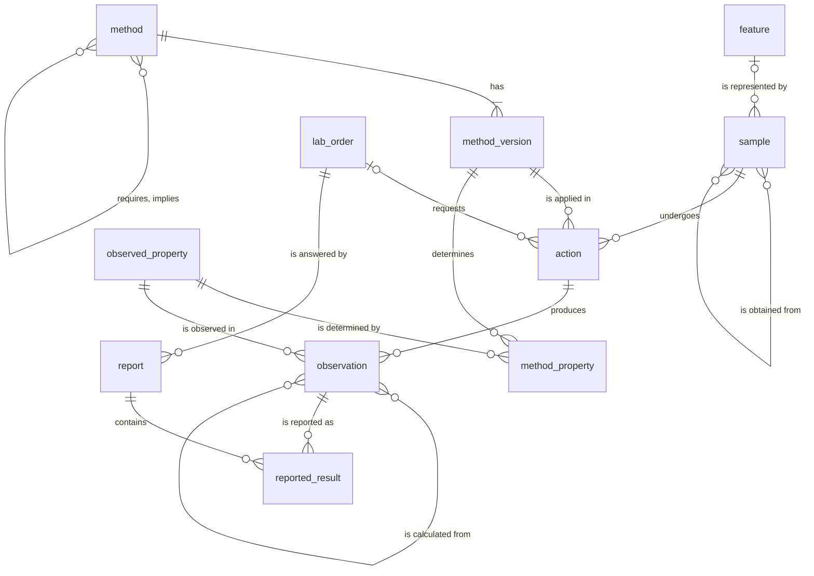
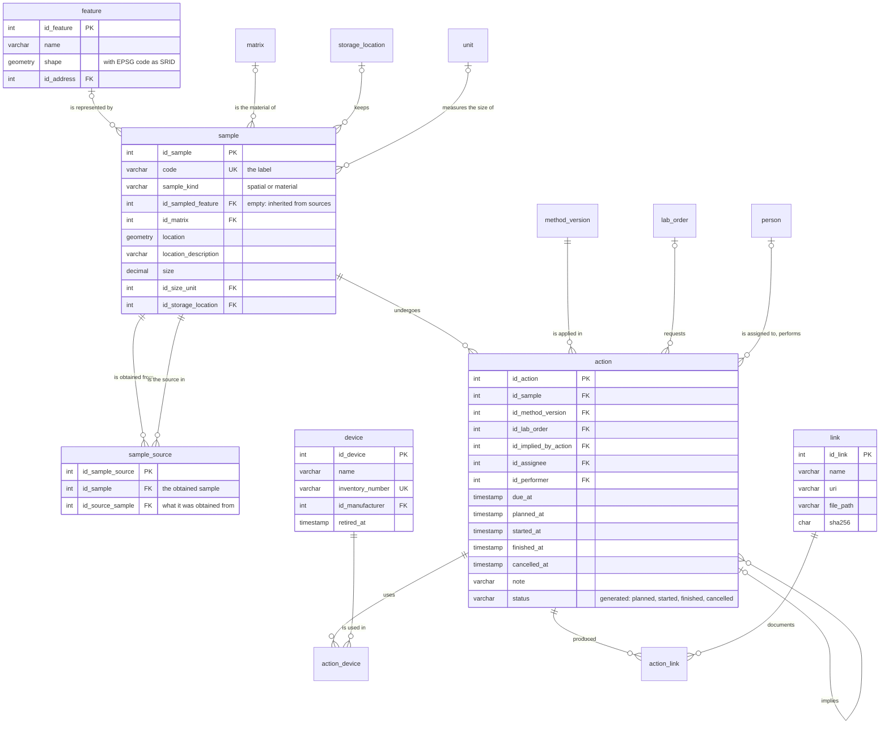
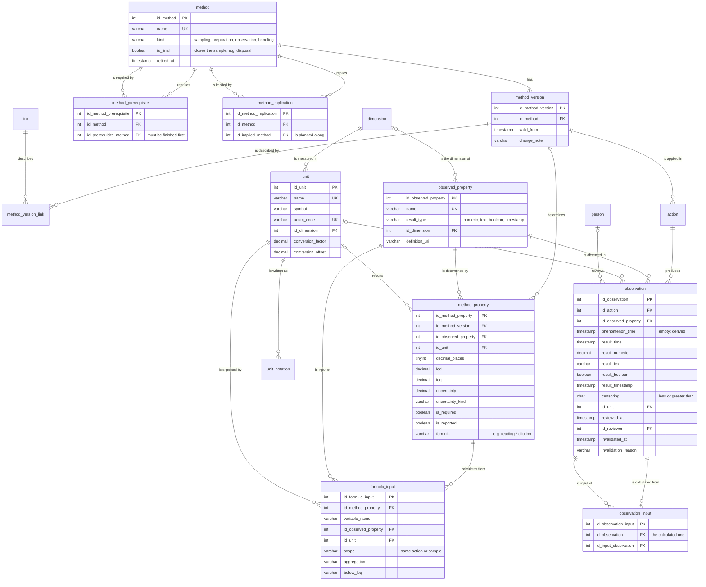
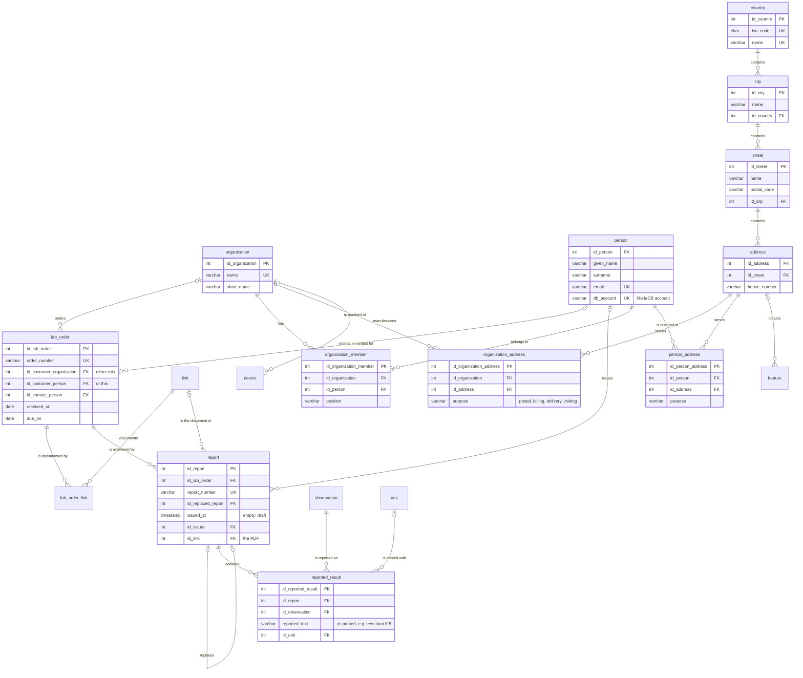

# Schema diagrams

The first diagram is the big picture. The three after it show every table and
every foreign key, one area at a time, with their most important columns.
The full definitions, with comments, are in [migrations/](../migrations/).

Reading the lines: `||` exactly one, `|o` zero or one, `o{` zero or more,
`|{` one or more. Every table also has a key `id_<table>` (shown as PK).
`schema_migration`, the bookkeeping table of `bin/migrate`, is left out.

## Overview

What is investigated (a *feature*) is represented by *samples*. Everything
that happens to a sample is an *action*: a version of a *method* applied to
it. Actions produce *observations* of *observed properties*. Orders ask for
actions; reports freeze what was told to the customer.

In OMS terms (see [oms-alignment.md](oms-alignment.md)): feature = ultimate
feature of interest, sample = Sample, method = Procedure, action = Sampling,
PreparationStep or the shared context of Observations, observation =
Observation, observed_property = ObservableProperty.

## Samples and their lifecycle

## Methods and results

## Orders, reports, people and places

